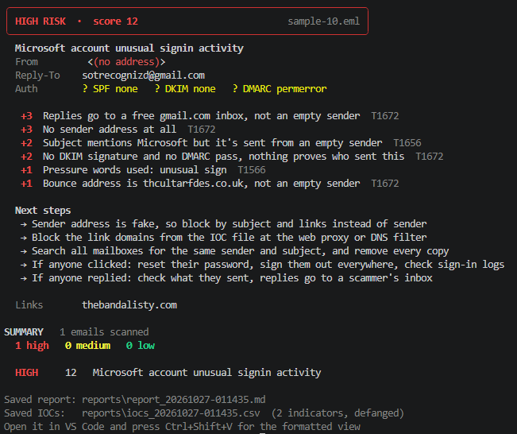

# Phishing Email Analyzer

A command line tool that reads email files, scores how likely each one is to be phishing, and writes a report an analyst can act on. On 55 real phishing emails it caught 76% with rules alone and 80% with VirusTotal, and it wrongly flagged 0 of 22 legit emails.

## Why I built this

I wanted hands-on practice with a core SOC task, which is looking at a suspicious email and deciding what to do about it. I hold Security+, so I knew the theory behind SPF, DKIM, DMARC and IOCs. This project made me apply it to real, messy emails.

## Screenshot



## Results

Measured with `measure.py` on 55 public phishing samples and 22 legit emails from my own inbox. An email counts as flagged if it scores MEDIUM or HIGH.

| | Rules only | With VirusTotal |
|---|---|---|
| Phishing caught | 42/55 (76.4%) | 44/55 (80.0%) |
| Legit wrongly flagged | 0/22 (0%) | 0/22 (0%) |
| Precision | 100% | 100% |

Some honest notes about these numbers.

- 22 legit emails is a small set. Zero false alarms here does not prove the real rate is zero. I'm growing it to about 50.
- Most missed emails are in German, Portuguese or Persian, or look like marketing spam. My word lists are English only, and those emails have normal looking headers.
- VirusTotal results depend on what it knows on the day, so those numbers can change.

## What it does

- Scans one `.eml` file or a whole folder. It finds emails by their content, so file names don't matter.
- Checks the sender, SPF, DKIM and DMARC results, Reply-To and Return-Path mismatches, brand impersonation, and lookalike domains like `paypa1.com`.
- Checks links for raw IP addresses, shorteners, free hosting and cheap TLDs.
- Checks attachments for risky or disguised file types like `invoice.pdf.exe`.
- Gives each email a score and a LOW, MEDIUM or HIGH verdict, with a MITRE ATT&CK ID on every finding.
- Suggests next steps for MEDIUM and HIGH emails, such as what to block and what to do if someone clicked.
- Saves a Markdown report and a CSV of defanged IOCs that can be imported into a SIEM.

## Quick start

There is nothing to install. The tool only uses the Python standard library.

```
python src/report.py path/to/emails            # scan a folder
python src/report.py path/to/email.eml         # scan one email
python src/report.py path/to/emails --vt       # also check VirusTotal
python src/measure.py phishing_dir legit_dir   # detection numbers
python -m unittest discover tests -v           # run the tests
```

For `--vt`, put `VT_API_KEY=your_key` in a `.env` file in the project folder. The free VirusTotal tier allows 4 lookups a minute, so the tool waits between calls and caches every answer.

## How scoring works

Each rule adds points. A score of 6 or more is HIGH, 3 to 5 is MEDIUM, and under 3 is LOW.

| Rule group | Example | Points |
|---|---|---|
| Sender | Sent from a free Microsoft tenant (onmicrosoft.com) | +2 |
| Authentication | DMARC failed | +3 |
| Reply-To | Replies go to a Gmail inbox, not the sender's company | +3 |
| Brand | Sender name says PayPal but the domain isn't PayPal's | +3 |
| Lookalike | Sender domain is `paypa1.com` | +3 |
| Links | Link points to a raw IP address | +3 |
| Language | Pressure words like "suspended" or bait like "you have won" | +1 each |
| Attachments | Risky or disguised file type | +3 |
| VirusTotal | 2 or more vendors flag a domain or file | +3 |

Some rules are softer on purpose. A Reply-To at another company only adds +1 when the email passes authentication, because big companies often use a sister domain for replies. A single VirusTotal vendor is ignored, because one flag alone is often a false alarm.

## Built to be safe

Everything in an email is written by the attacker, so the tool treats all of it as hostile.

- **Zero dependencies.** Every pip package is someone else's code running on your machine. Using only the standard library keeps that list empty.
- **Never visits links or opens attachments.** It only sends domains and file hashes to VirusTotal to ask what it already knows.
- **Defangs what it saves.** `https://` becomes `hxxps://` and `evil.com` becomes `evil[.]com`, so nothing in a report is clickable.
- **Strips control characters** before printing, so a subject line can't hide terminal escape codes.
- **Protects the CSV** from formula injection when it's opened in Excel.
- **No HTML report.** Rendering attacker content as a web page is a risk I chose to avoid.

## How it improved

The first version caught 3 of 5 test emails as MEDIUM, none as HIGH, and flagged a real newsletter twice by mistake. The newsletter came from subdomains of one company, and my code saw that as a mismatch. Comparing root domains fixed it, and adding sender, authentication, brand and bait rules got it to 5 of 5. After that I added lookalike domains, link and attachment checks, VirusTotal, ATT&CK tags, next steps and the IOC export, and grew the test set to 77 emails.

## Limitations

- Word lists are English only, which causes most of the misses.
- DKIM alignment isn't checked. The tool reads the DKIM result but doesn't confirm the signing domain matches the From address. This matters most when an email has no DMARC result.
- The root domain logic is simple and only knows a few two-part endings like `co.uk`.
- Brand names that are normal words can cause false alarms. A domain like `generalledger.example` gets called a Ledger lookalike.
- The legit test set is small.

## What's next

- Grow the legit set to about 50 emails
- Flag links where the visible text says one site but the link goes somewhere else
- Add tests for every rule, not just the brand checks
- Compare the rules against a machine learning model trained on public datasets

## Project layout

```
src/parser.py      reads emails, pulls out headers, links and attachments
src/report.py      scoring, terminal output, Markdown report, IOC CSV
src/vt_client.py   VirusTotal lookups with caching and rate limits
src/measure.py     detection rate and false positive rate
tests/             unit tests using made-up emails
```

## Test data and credits

Phishing samples come from the public [phishing_pot](https://github.com/rf-peixoto/phishing_pot) collection. My own emails are not in this repo. I built this with Claude Code as a coding assistant, and the design and security decisions were mine.
